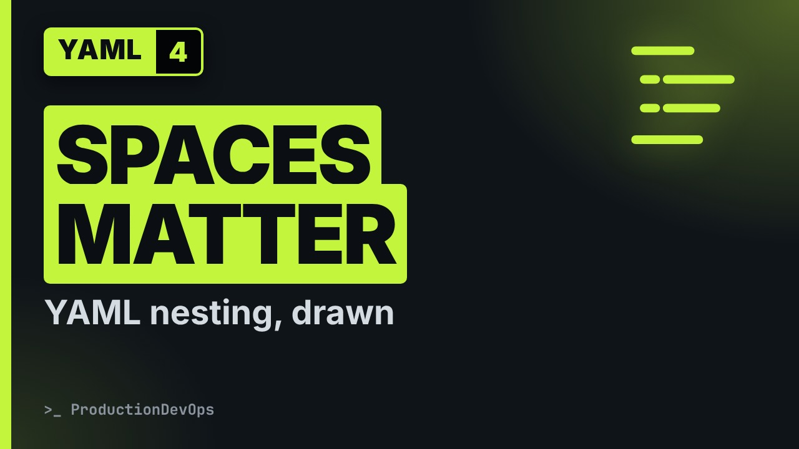
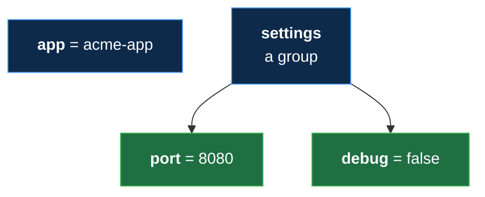
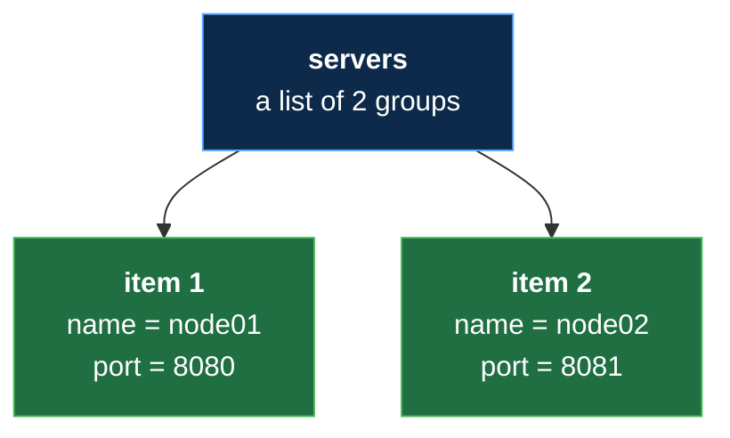

# YAML Nesting: Why Spaces Matter (YAML from Zero, No Experience Needed)



**Video:** https://youtu.be/7NwMrQP7Kgo

In YAML, the spaces at the start of a line decide what belongs to what. This lesson of YAML from Zero shows nesting, a group of settings under one key, and how YAML reads those spaces: same spaces, same group; more spaces, inside the line above; fewer spaces, the group is over. We break a file with one space too many, move a setting out of its group without any error, see why the Tab key is never allowed, and finish with a list of groups: the shape you will meet in every Kubernetes file. No terminal, nothing to install, no experience needed. The files, the challenge and its solution are in the demos repo.

## Files in this folder

- [`acme-app.yaml`](acme-app.yaml)
- [`challenge.yaml`](challenge.yaml)
- [`servers.yaml`](servers.yaml)
- [`challenge-solution.md`](challenge-solution.md) (solution of the challenge: try it yourself first)

## What you need

A Linux shell (a VM, WSL or a container is fine). Everything runs inside this folder.

## The lesson, step by step

The same explanations as the video, with every command. Read it, then run it yourself.

Real config files have groups inside groups. Only spaces hold them together. At the end: the shape you will see in every Kubernetes file.

For this lesson you need nothing. Just watch. No terminal today, only small text files. About five minutes.

### The plan

This is lesson four of YAML from Zero. First, a group of settings under one key. Then, how YAML reads the spaces at the start of a line. Then, one space too many, and one too few. And finally, a list of groups.

### Nesting

- `nesting — Putting settings inside a group, under one key (like a section on a form: "Address", with street and city under it)`: 
First word: nesting. It means putting settings inside a group, under one key. Like the address section on a form.

- `indentation — The spaces at the start of a line (like a table of contents: each sub-chapter is pushed to the right)`: 
Second word: indentation. It means the spaces at the start of a line. Like a table of contents, where sub-chapters are pushed to the right.

```
app: acme-app
settings:
  port: 8080
  debug: false
```

Line one starts at the left edge, with no spaces. It is a top level setting. Settings has nothing after its colon. So a group starts here. Port and debug start with two spaces. So they belong to settings.

**The same file, as a picture**



This is what YAML reads. Two things at the top: app, and the group settings. Inside settings: port and debug.

### Reading spaces

How does YAML read the spaces? Same spaces as the line above: the same group. More spaces: it goes inside the key above. Fewer spaces: that group is over.

```
app: acme-app
settings:
  port: 8080
  debug: false
servers:
  - node01
  - node02
```

The top of the file, as before: app, then the settings group. Servers is back at the left edge. Fewer spaces, so the settings group is over. Then the list of servers from lesson three, two spaces in, inside servers.

### So far

So far: nesting is a group of settings under one key. The spaces at the start of a line say what belongs to what. Next: wrong spaces. Then the shape of every Kubernetes file.

### Wrong spaces

```
settings:
  port: 8080
   debug: false
```

Look at debug. It has three spaces, not two. Is debug next to port, or inside it? Port already has a value. YAML cannot decide. So the program stops with an error. One space, and the whole file is refused.

```
app: acme-app
settings:
  port: 8080
debug: false
```

Now debug has no spaces at all. This is valid YAML. But debug is no longer inside settings. It moved to the top. A program that looks for debug inside settings will not find it. And no error tells you.

- `tab — A key that jumps right in one step: one invisible character (like a sticker that looks like spaces, but is one single piece)`: 
Last word: tab, the key that jumps right in one step. It looks like spaces, but it is one invisible character.

YAML refuses a tab at the start of a line. The program stops with an error. And you cannot see it, because a tab looks like spaces. So set your text editor to type spaces when you press the Tab key.

### A list of groups

- `list of groups — A list where each item is a group of keys (like a stack of forms: each one has the same fields)`: 
Now the payoff. A list of groups is a list where each item is a group of keys. Like a stack of forms, each with the same fields.

```
servers:
  - name: node01
    port: 8080
  - name: node02
    port: 8081
```

Servers is a list, as in lesson three. The dash starts item one. But this item is a group. Its first key is name. Port lines up with name, not with the dash. So port is in the same group as name. A new dash starts item two: another group, with its own name and port.

**A list of groups, drawn**



Two forms in a stack. Each item has a name and a port. Kubernetes lists its containers exactly this way.

### Good to know

Two spaces per level is the usual habit. Any number works, if each group lines up. And a group can fit on one line, inside curly braces.

```
app: acme-app
settings:
  port: 8080
debug: false
```

Your challenge. Is debug inside settings? If not, how do you put it there?

### Recap

Recap: nesting is a group under one key. Same spaces, same group. More spaces, inside the key above. Spaces only, never tabs. And a list item can be a group. Your challenge: put debug inside settings. How many spaces? The answer is in the demo repo.

### Where next

Where next? Lesson five: text, numbers, true and false. And when a value needs quotes.

Next lesson: text, numbers, true and false. Subscribe so you do not miss it.

## Challenge

Your challenge: put debug inside settings. How many spaces? The answer is in the demo repo.

When you have tried: [`challenge-solution.md`](challenge-solution.md).

---

From the [ProductionDevOps](https://www.youtube.com/@production-devops) channel: real-world DevOps and SRE, explained with real commands.
