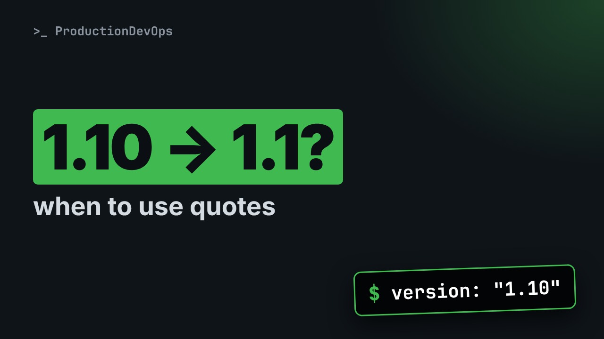

# YAML Text, Numbers, True and False: When to Use Quotes (YAML from Zero, No Experience Needed)



**Video:** coming soon on the [channel](https://www.youtube.com/@production-devops).

In YAML you never say what kind a value is: YAML guesses. This lesson of YAML from Zero shows the three kinds of values, text, numbers and true or false, how YAML guesses which is which, and the days it guesses wrong: a version 1.10 that becomes 1.1, an id 007 that loses its zeros, a yes or a NO that some tools read as true or false. Then quotes fix every one of them, and four simple rules tell you when to use them. No terminal, nothing to install, no experience needed. Every new word is explained on screen. The files, the challenge and its solution are in the demos repo.

## Files in this folder

- [`challenge.yaml`](challenge.yaml)
- [`kinds.yaml`](kinds.yaml)
- [`right.yaml`](right.yaml)
- [`wrong.yaml`](wrong.yaml)
- [`challenge-solution.md`](challenge-solution.md) (solution of the challenge: try it yourself first)

## What you need

A Linux shell (a VM, WSL or a container is fine). Everything runs inside this folder.

## The lesson, step by step

The same explanations as the video, with every command. Read it, then run it yourself.

In YAML, you never say what kind a value is. YAML guesses. Today: how it guesses, and how version one point ten becomes one point one.

For this lesson you need nothing. Just watch. No terminal today, only small text files. About five minutes.

### The plan

This is lesson five of YAML from Zero. First, three kinds of values. Then, how YAML guesses the kind. Then, when the guess goes wrong. And quotes, which say: take it exactly as written.

### Three kinds

- `type — The kind of a value: text, a number, or true or false (like the kind of box on a form: a text box, a number box, a tick box)`: 
First word: type. The type is the kind of a value. Like the boxes on a form: a text box, a number box, a tick box.

- `string — Programmers' word for a piece of text (like letters on a string, like beads on a thread)`: 
Second word: string. It is the programmers' word for a piece of text. Think of letters on a string, like beads.

- `boolean — A value that can only be true or false (like a tick box: ticked or not ticked)`: 
Third word: boolean. A boolean can only be true or false. Like a tick box: ticked, or not ticked.

```
app: acme-app
port: 8080
debug: false
```

Acme app is text, so a string. Eight zero eight zero is a number. False is a boolean. Debug is switched off.

### How YAML guesses

How does YAML guess? Only digits, maybe with a dot: it is a number. True or false: it is a boolean. Anything else is text. So plain text needs no quotes. The owner is ops team.

### So far

So far: three kinds of values. Text, numbers, and true or false. YAML guesses the kind from how the value looks. Next: the guess goes wrong. And version one point ten shrinks.

### Wrong guesses

```
version: 1.10
id: 007
debug: yes
country: NO
```

Version one point ten looks like a number. As a number, it is one point one. The zero is gone. The id double zero seven also looks like a number. It becomes seven. Yes is meant as a tick box. But not every tool reads it that way. And NO, the country code of Norway, becomes false in many tools.

You wrote one point ten. The program reads one point one. You wrote double zero seven. The program reads seven. Yes, no, on and off: some tools read true or false, others read text. And there is no error. The meaning simply changed.

### Quotes

- `quotes — Marks around a value: this is text, keep it exactly as written (like a box on a form marked "copy exactly")`: 
The fix is quotes. Quotes around a value say: this is text, keep it exactly as written.

```
version: "1.10"
id: "007"
debug: true
country: "NO"
```

In quotes, the version and the id stay text. One point ten, double zero seven. Debug really is a tick box. So write true. Every tool reads true the same way. The country code is text, so it goes in quotes too.

### Rules

Four rules. If it looks like a number but is not one, use quotes. For a real yes or no, write true or false. Never yes, no, on or off. A colon followed by a space, or a hash sign, inside text: use quotes. And if you are in doubt about a piece of text, quote it.

### Good to know

Single quotes or double quotes: both work for simple text. A key with nothing after it, and nothing below it, has no value at all. Why do tools differ? There are two versions of the YAML rules, old and new.

```
app: acme-app
release: 2.10
debug: no
owner: ops
```

Your challenge. Two of these values will not be read as written. Which two?

### Recap

Recap: three kinds of values. Text, number, boolean. YAML guesses the kind, and sometimes it guesses wrong. Quotes keep a value as written. For booleans, write true or false. Your challenge: find and fix the two values. The answer is in the demo repo.

### Where next

Where next? Lesson six: comments, and text on many lines. Notes for people, and long messages for programs.

Next lesson: comments and multi-line text. Subscribe so you do not miss it.

## Challenge

Your challenge: find and fix the two values. The answer is in the demo repo.

When you have tried: [`challenge-solution.md`](challenge-solution.md).

---

From the [ProductionDevOps](https://www.youtube.com/@production-devops) channel: real-world DevOps and SRE, explained with real commands.
