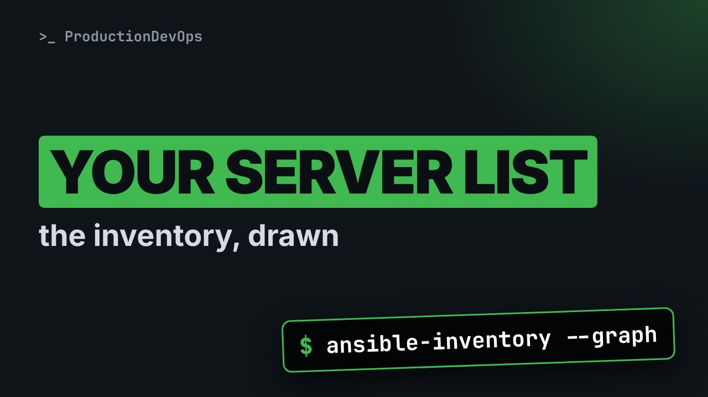
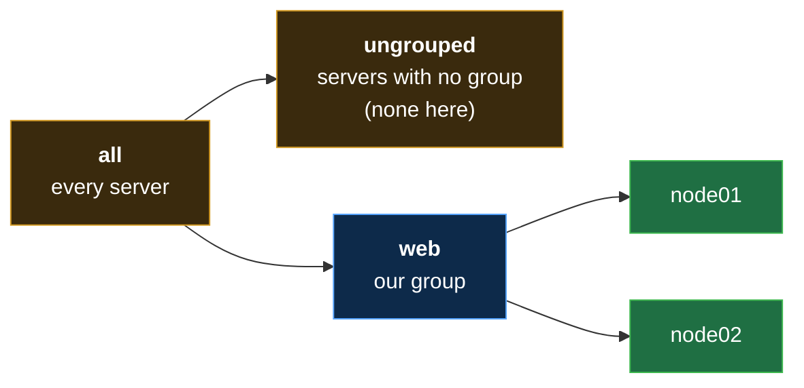

# Your Ansible Inventory: the List of Servers, ansible-inventory --graph (No Experience Needed)



**Video:** https://youtu.be/9Ow1sKpmQYc

Ansible can talk to your servers, but which ones? This lesson of Ansible from Zero writes the inventory, the list of servers Ansible looks after, line by line: a group in square brackets and one server per line. Then a two-line settings file tells Ansible where the list is, and you type your first command, ansible-inventory --graph, which draws the list as a tree, with two groups you never wrote. No experience needed: every new word is explained on screen. The files, the setup guide, the challenge and its solution are in the demos repo.

## Files in this folder

- [`ansible.cfg`](ansible.cfg)
- [`inventory.ini`](inventory.ini)
- [`lab/up.sh`](lab/up.sh)
- [`challenge-solution.sh`](challenge-solution.sh) (solution of the challenge: try it yourself first)
- [`setup.md`](setup.md)

## What you need

A Linux shell (a VM, WSL or a container is fine). Everything runs inside this folder.

## The lesson, step by step

The same explanations as the video, with every command. Read it, then run it yourself.

Ansible can talk to your servers, but which ones? Today you write the list, and Ansible draws it, with two groups you never wrote.

To watch this lesson, you need nothing. To follow along, you need a Linux terminal with Ansible installed. The setup guide and the files are in the demo repo.

### The plan

This is lesson four of Ansible from Zero. First, the inventory: the list of servers. Then groups: one name for many servers. Then a small settings file. And your first command. Ansible draws the list for us.

### The inventory

- `inventory`: The list of servers that Ansible looks after (like the list of kitchens, on the wall of the head chef's office)
First word: inventory. It is the list of servers that Ansible looks after. Like the list of kitchens on the head chef's wall.

Here is our whole inventory. Three lines, in a file called inventory dot ini.

```
[web]
node01
node02
```

The first line is a name, in square brackets. The next lines are our two practice servers.

- `group`: One name for several servers, to talk to them together (like "the pizza kitchens": one name, many kitchens)
Second word: group. A group is one name for several servers. Like the pizza kitchens: one name, many kitchens.

```
[web]
node01
node02
```

Square brackets mean: a group starts here. This group is called web, for web servers. Then one server per line. The first one is node zero one. The second one is node zero two. Both belong to the group web.

This file is not YAML. It is a simpler and older format, called ini. Each name in the list must lead to a real server. In real life, that is a server name, or an address written after the name. In our lab, the two names already lead to the practice servers.

All together: a group called web, with two servers in it. This is the list Ansible will use.

```
[web]
node01
node02
```

### The settings file

- `ansible.cfg`: Ansible's settings file, read first, in the folder where you type (like the notebook on the head chef's desk)
How does Ansible find the list? With its settings file, ansible dot cfg. Ansible reads it first, in the folder where you type.

```
[defaults]
inventory = inventory.ini
```

The same simple format. Square brackets start a section: the main settings. And one setting: the inventory is the file inventory dot ini, in this folder.

### So far

So far: the inventory file has a group, then one server per line. The settings file says where the inventory is. Next: we ask Ansible what it really read. And meet two groups we never wrote.

### Your first command

```console
$ ansible-inventory --graph
```

Here is the one new command of this lesson.

- `ansible-inventory`: show the inventory
Ansible dash inventory shows the inventory, the way Ansible reads it.

- `--graph`: draw it as a tree
Dash dash graph means: draw it as a tree.

Which servers does Ansible know? We type the command.

```console
$ ansible-inventory --graph
```

At the bottom, our group web, with node zero one and node zero two. But look at the top. There is a group called all, and one called ungrouped. We never wrote them.

**Two groups for free**



Ansible always makes these two. All means every server in the list. Ungrouped holds servers with no group, and here it is empty.

Now we ask for one group only. Same command, and the group name at the end.

```console
$ ansible-inventory --graph web
```

Only web, with its two servers. Ansible only read the list. It did not contact any server.

### Good to know

All always means every server in the list. You will use it in the next lesson. A server can be in more than one group. And type your commands in the folder that holds ansible dot cfg.

### Recap

Recap: the inventory is the list of servers. A name in brackets starts a group. Ansible dot cfg tells Ansible where the list is. Ansible dash inventory dash dash graph draws the list as a tree. Your challenge: add a group called d b, with node zero two in it. Run the command. Where does node zero two appear?

### Where next

Where next? Lesson five: your first ad hoc command. We ask every server in the list: are you there?

Next lesson: your first ad hoc command. Subscribe so you do not miss it.

## All the commands, to copy

Run them from inside this folder, in this order (some are expected to fail: that is the point of the demo).

```bash
ansible-inventory --graph
ansible-inventory --graph web
```

## Challenge

Your challenge: add a group called d b, with node zero two in it. Run the command. Where does node zero two appear?

When you have tried: [`challenge-solution.sh`](challenge-solution.sh).

---

From the [ProductionDevOps](https://www.youtube.com/@production-devops) channel: real-world DevOps and SRE, explained with real commands.
