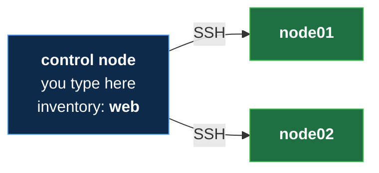
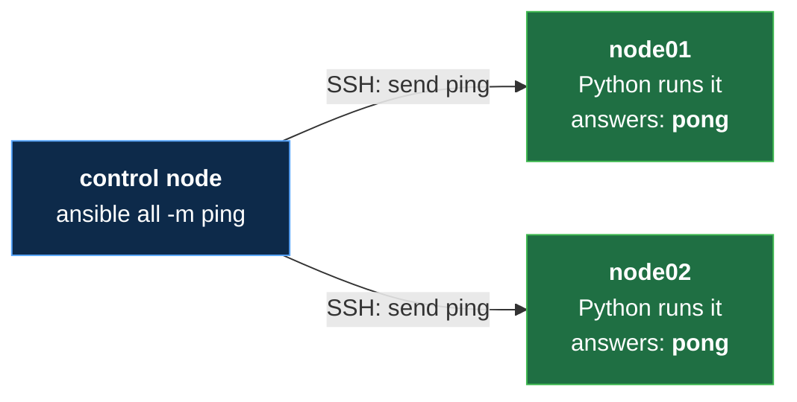

# Your First Ansible Ad Hoc Command: ansible all -m ping (No Experience Needed)


**Video:** https://youtu.be/O-DsDxHKrOA

Two servers are waiting: can Ansible reach them? This lesson of Ansible from Zero types your first ad hoc command, one quick instruction that is not saved in a file: ansible all -m ping. We take it apart piece by piece, run it on two practice servers, and read the answer line by line, including the one line that comes back in every lesson of this course. Then the same command for a single server. No experience needed: every new word is explained on screen. The files, the challenge and its solution are in the demos repo.

## Files in this folder

- [`ansible.cfg`](ansible.cfg)
- [`inventory.ini`](inventory.ini)
- [`lab/up.sh`](lab/up.sh)
- [`challenge-solution.sh`](challenge-solution.sh) (solution of the challenge: try it yourself first)

## What you need

A Linux shell (a VM, WSL or a container is fine). Everything runs inside this folder.

## Before you start

The video runs these commands first, off screen:

```bash
if [ -f .lab-reset ]; then bash lab/up.sh; else bash lab/up.sh reset && touch .lab-reset; fi >/dev/null 2>&1
```

## The lesson, step by step

The same explanations as the video, with every command. Read it, then run it yourself.

Two servers are waiting. Today you ask both of them one question, with one line. And one line of the answer will come back in every lesson.

To watch this lesson, you need nothing. To follow along, start the two practice servers. The setup guide of lesson four, in the demo repo, shows how.

### The plan

This is lesson five of Ansible from Zero. First, one more line in the settings file. Then, what an ad hoc command is. Then we ask every server: are you there? And we read the answer, line by line.

**Our lab, so far**



Here is our lab. You type on the control node. Its inventory lists two servers, in the group web.

### Settings

```
[defaults]
inventory = inventory.ini
interpreter_python = /usr/bin/python3
```

Here is the settings file from lesson four. The main settings, and where the list is. One new line: which Python the servers use. Without it, Ansible guesses, and prints a warning.

### Ad hoc

- `ad hoc command`: One quick instruction, typed once, not saved in a file (like a quick phone call to every kitchen)
New word: ad hoc command. It is one quick instruction, typed once, and not saved in a file. Like a quick phone call to every kitchen.

- `ping module`: Checks that Ansible can log in, and that Python can run a module (like calling a kitchen: "are you there, and ready to cook?")
Our question is the ping module. It checks that Ansible can log in, and that Python can run a module. Are you there, and ready to cook?

```console
$ ansible all -m ping
```

Here is the one new command of this lesson. Four pieces.

- `ansible`: run one quick task
Ansible is the program for ad hoc commands.

- `all`: on which servers
All says on which servers: every server in the inventory.

- `-m`: the module to run
Dash m means: here comes the module to run.

- `ping`: the module
And ping is the module.

### Ask every server

Can Ansible reach every server? We type the command.

```console
$ ansible all -m ping
```

Two answers, one per server. Both say SUCCESS, in green.

```
node01 | SUCCESS => {
    "changed": false,
    "ping": "pong"
}
```

Here is one answer, from node zero one. First the server's name, then SUCCESS: it worked. Now the line that comes back in every lesson. Changed, false: nothing on the server was changed. And the module's answer: ping, pong. The server is there, and ready.

**What just happened**



This is the picture of lesson two. Ansible logged in to both servers over SSH. Python ran the ping module, and each server answered pong.

### So far

So far: an ad hoc command is one quick instruction, not saved. Ansible all dash m ping asks every server, and each answers pong. Next: the same question, to just one server.

### One server

Instead of all, we write one name from the list: node zero one.

```console
$ ansible node01 -m ping
```

One answer only, from node zero one. Node zero two was not contacted.

So the second word chooses the servers. All means every server in the inventory. A group name, like web, means every server in that group. And one name means just that server.

### Good to know

This is not the network ping. That one checks the network only. This one logs in, and runs Python. The answers can come in any order, because the servers work at the same time. An ad hoc command is not saved. For jobs you repeat, you write a playbook, in lesson seven.

### Recap

Recap: an ad hoc command is one quick instruction, typed once. Ansible, then which servers, then dash m and the module. The answer: success, changed false, and pong. Your challenge: ping the group web. How many answers do you get? The solution is in the demo repo.

### Where next

Where next? Lesson six: modules that really change something. A folder and a file on a server, in one line each. And changed becomes true.

Next lesson: modules, ready-made tasks. Subscribe so you do not miss it.

## All the commands, to copy

Run them from inside this folder, in this order (some are expected to fail: that is the point of the demo).

```bash
ansible all -m ping
ansible node01 -m ping
```

## Challenge

Your challenge: ping the group web. How many answers do you get? The solution is in the demo repo.

When you have tried: [`challenge-solution.sh`](challenge-solution.sh).

---

From the [ProductionDevOps](https://www.youtube.com/@production-devops) channel: real-world DevOps and SRE, explained with real commands.
