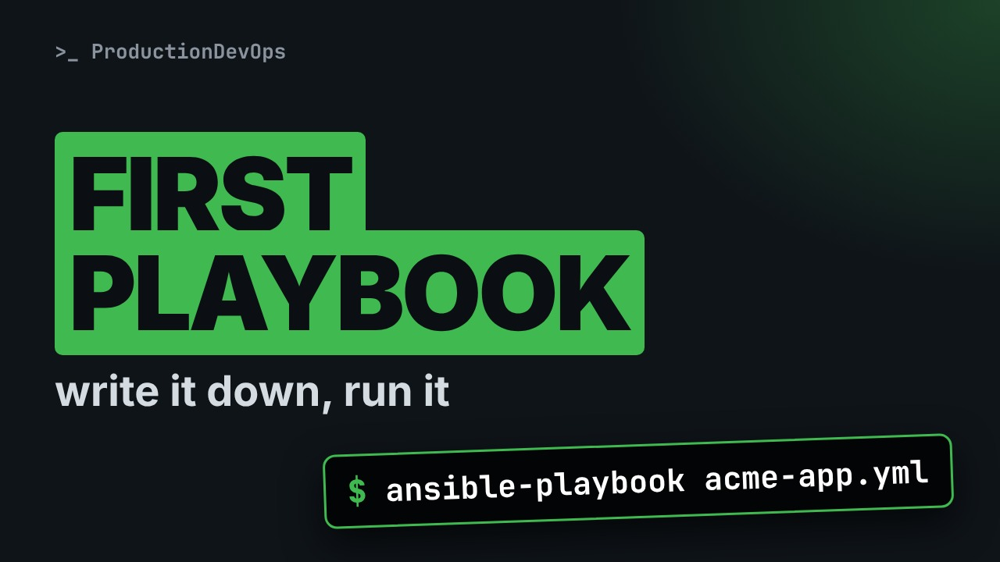
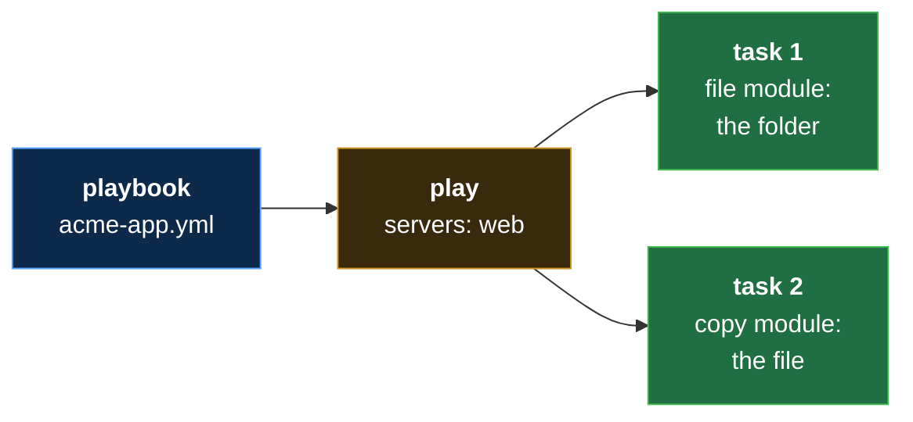

# Your First Ansible Playbook, Line by Line: ansible-playbook (No Experience Needed)



**Video:** coming soon on the [channel](https://www.youtube.com/@production-devops).

Ad hoc commands are gone once they have run. A playbook writes the jobs down, so you can run them again on every server. This lesson of Ansible from Zero reads a first playbook as a map, then line by line: a play, the servers it is for, and two tasks, the folder and the file from lesson 6. Then ansible-playbook checks the spelling without touching any server, runs the playbook on two practice servers, and we read every part of its output, down to the play recap. No experience needed: every new word is explained on screen. The files, the challenge and its solution are in the demos repo.

## Files in this folder

- [`acme-app.yml`](acme-app.yml)
- [`ansible.cfg`](ansible.cfg)
- [`hello.txt`](hello.txt)
- [`inventory.ini`](inventory.ini)
- [`lab/up.sh`](lab/up.sh)
- [`acme-app-logs.yml`](acme-app-logs.yml)
- [`challenge-solution.sh`](challenge-solution.sh) (solution of the challenge: try it yourself first)

## What you need

A Linux shell (a VM, WSL or a container is fine). Everything runs inside this folder.

## Before you start

The video runs these commands first, off screen:

```bash
if [ -f .lab-reset ]; then bash lab/up.sh; else bash lab/up.sh reset && touch .lab-reset; fi >/dev/null 2>&1
```

## The lesson, step by step

The same explanations as the video, with every command. Read it, then run it yourself.

An ad hoc command is gone once it has run. Today you write the job down, in a file. And Ansible checks the spelling before it touches any server.

To watch this lesson, you need nothing. To follow along, start the two practice servers, as in lesson four. The two files of this lesson are in the demo repo.

### The plan

This is lesson seven of Ansible from Zero. First, what a playbook is. Then our playbook, as a map. Then line by line. And we check it, then run it on both servers.

### Playbook

- `playbook`: A file of tasks for Ansible, to run again and again (like the recipe card, written down: every kitchen follows it)
New word: playbook. It is a file of tasks for Ansible, to run again and again. Think of the recipe card, written down.

- `task`: One step of a playbook: one module, with its details (like one line of the recipe: "preheat the oven to 200")
Each step in a playbook is a task. A task is one module, with its details. One line of the recipe.

- `play`: A part of a playbook: which servers, and which tasks (like "for the pizza kitchens: these steps")
The tasks sit inside a play. A play says which servers, and which tasks. For the pizza kitchens, these steps.

**Playbook, play, tasks**



Here is our playbook. One play, for the group web, with two tasks. The folder and the file from lesson six.

### The map

Here is the whole file. You saw its start in lesson three. It has three parts.

```
# Lesson 7: our first playbook
- name: Prepare acme-app
  hosts: web
  gather_facts: false
  tasks:
    - name: Create the app folder
      ansible.builtin.file:
        path: /tmp/acme-app
        state: directory

    - name: Copy the welcome file
      ansible.builtin.copy:
        src: hello.txt
        dest: /tmp/acme-app/hello.txt
```

Part one: the play. Which servers, and a few settings. Part two: the first task, the folder. Part three: the second task, the file.

### Line by line

```
# Lesson 7: our first playbook
- name: Prepare acme-app
  hosts: web
  gather_facts: false
  tasks:
```

A comment, then a dash: the play starts. Its name is for people. Ansible prints it when it runs. Hosts says which servers: the group web, from lesson four. Gather facts, false. Ansible skips a warm-up step that collects details about each server. We do not need them today. Tasks: the list of tasks comes below.

```
    - name: Create the app folder
      ansible.builtin.file:
        path: /tmp/acme-app
        state: directory
```

A dash: one task of the list, with a name. Then the module, with its full name: ansible dot builtin dot file. The file module from lesson six. And its details, one per line: the same path and state we gave to dash a.

So, compared with lesson six. The server name became hosts: web. Dash m file became the module's full name. And dash a became one key and value per line. And now it is written down, to run any time.

```
    - name: Copy the welcome file
      ansible.builtin.copy:
        src: hello.txt
        dest: /tmp/acme-app/hello.txt
```

The second task, at the same indentation as the first. It uses the copy module. Its details. From hello dot text, here on the control node. To the new folder, on the server.

All together now. One play for the servers in web: make the folder, then copy the file into it.

```
# Lesson 7: our first playbook
- name: Prepare acme-app
  hosts: web
  gather_facts: false
  tasks:
    - name: Create the app folder
      ansible.builtin.file:
        path: /tmp/acme-app
        state: directory

    - name: Copy the welcome file
      ansible.builtin.copy:
        src: hello.txt
        dest: /tmp/acme-app/hello.txt
```

### So far

So far: a playbook is a file with a play and its tasks. Each task is a module, with its details. Next: Ansible checks the spelling, and then we run it.

### Check it

```console
$ ansible-playbook --syntax-check acme-app.yml
```

Here is the one new command of this lesson, with a safety option first.

- `ansible-playbook`: run a playbook
Ansible dash playbook runs a playbook.

- `--syntax-check`: only check the spelling
Dash dash syntax check means: only read the file, and check its spelling.

- `acme-app.yml`: which playbook
And this is the playbook.

Is the file written correctly? We ask, without touching any server.

```console
$ ansible-playbook --syntax-check acme-app.yml
```

Ansible only prints the playbook's name. That means: no spelling mistake found.

### Run it

Now we run it for real. The same command, without the option.

```console
$ ansible-playbook acme-app.yml
```

At the top, PLAY, with the name we wrote. Then one TASK line per task, with its name. Under each task, one line per server. Changed, in yellow, on both. At the bottom, the play recap: one line per server.

In the recap, ok equals two: two tasks ran fine. Changed equals two: both tasks changed the server. Unreachable and failed are zero: no problems. The other counters are for later courses.

### Good to know

Tasks run in order, from top to bottom. The syntax check finds spelling mistakes only. It cannot know if a path is the right one.

### Recap

Recap: a playbook holds a play, and the play holds tasks. Each task is a module. Ansible dash playbook dash dash syntax check reads the file first. Ansible dash playbook runs it, and the recap says what happened. Your challenge: add a third task, a folder called logs, inside acme app. Run it. How many changed per server?

### Where next

Where next? Lesson eight: we run this playbook twice. And we see why nothing breaks, and why that matters.

Next lesson: run it twice, nothing breaks. Subscribe so you do not miss it.

## All the commands, to copy

Run them from inside this folder, in this order (some are expected to fail: that is the point of the demo).

```bash
ansible-playbook --syntax-check acme-app.yml
ansible-playbook acme-app.yml
```

## Challenge

Your challenge: add a third task, a folder called logs, inside acme app. Run it. How many changed per server?

When you have tried: [`challenge-solution.sh`](challenge-solution.sh).

---

From the [ProductionDevOps](https://www.youtube.com/@production-devops) channel: real-world DevOps and SRE, explained with real commands.
