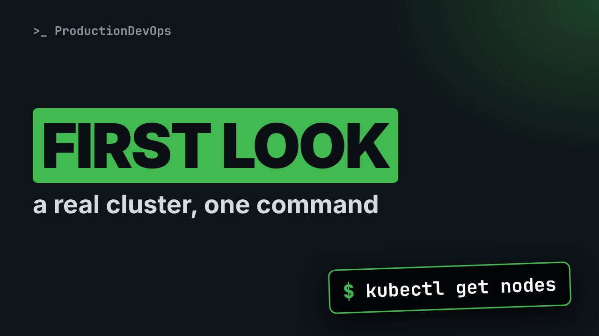
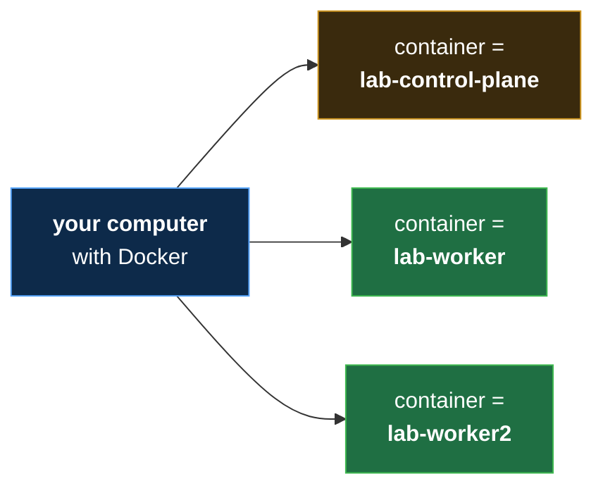
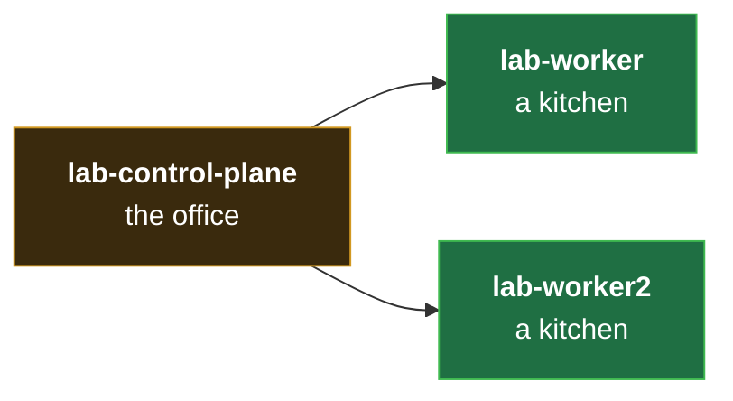

# Your First Look at a Kubernetes Cluster: kind and kubectl get (No Experience Needed)



**Video:** coming soon on the [channel](https://www.youtube.com/@production-devops).

You have heard about clusters, now see a real one, running on a normal computer. This lesson of Kubernetes from Zero explains kind, a practice cluster inside Docker, and kubectl, the program that talks to the cluster. Then you type your first Kubernetes command, kubectl get, and read every column of its answer. No experience needed: every new word is explained on screen. The setup guide, the challenge and its solution are in the demos repo.

## Files in this folder

- [`challenge-solution.sh`](challenge-solution.sh) (solution of the challenge: try it yourself first)
- [`kind-lab.yaml`](kind-lab.yaml)
- [`setup.md`](setup.md)

## What you need

A Linux shell (a VM, WSL or a container is fine). Everything runs inside this folder.

The outputs below were captured for real on the lab cluster. On yours, names, ages, IPs and ports will differ; everything else should match.

## The lesson, step by step

The same explanations as the video, with every command and its real output. Read it, then run it yourself.

In lesson three we drew a cluster. Today you see a real one, running on a normal computer. One command is enough to see it.

You need nothing. You can just watch. To follow along, you need a terminal, Docker, kind and kubectl. The setup guide is in the demo repo, step by step.

### The plan

This is lesson four of Kubernetes from Zero. First, a practice cluster on one computer. Then the program that talks to it. Then your first command. And the same command, a second time.

### kind

- `kind`: A tool that makes a small practice cluster on your computer (like a practice kitchen at home: real tools, smaller size)
First word: kind. Kind makes a small practice cluster on your computer. Think of a practice kitchen at home: real tools, smaller size.

**kind: Kubernetes in Docker**



The name means Kubernetes in Docker. Each node of the cluster is a container, like in lesson two. Our practice cluster has three nodes.

Another tool, minikube, does the same job. You can pick either one. A practice cluster is real Kubernetes, just small. You can break it, delete it, and make a new one. It is yours.

### kubectl

- `kubectl`: The program you use to talk to a cluster (like the phone to the manager's office: you ask, the office answers)
Second word: kubectl, often said cube control. It is the program you use to talk to a cluster. It is your phone to the manager's office.

**You ask, the office answers**


You type a command. Kubectl sends the question to the control plane, and prints the answer on your screen.

### First command

```console
$ kubectl get nodes
```

Here is your first command. It has three pieces.

- `kubectl`: talk to the cluster
Kubectl: we talk to the cluster.

- `get`: show me a list
Get: show me a list.

- `nodes`: of what: the nodes
Nodes: a list of what? Of the nodes, the computers of the cluster.

Which computers are in our cluster? We ask.

```console
$ kubectl get nodes
NAME                STATUS   ROLES           AGE   VERSION
lab-control-plane   Ready    control-plane   14d   v1.37.0
lab-worker          Ready    <none>          14d   v1.37.0
lab-worker2         Ready    <none>          14d   v1.37.0
```

The first column, NAME, has our three nodes. STATUS says Ready: each node is ready to work. ROLES shows the office. Control plane is the office, and the two others are workers. The last column is the Kubernetes version that each node runs.

**Lesson 3's drawing, for real**



This is the drawing from lesson three, now with real names. One office, and two kitchens.

### So far

So far: kind gives us a practice cluster, inside Docker. Kubectl get nodes lists the computers of the cluster. Next: the same command, to ask about apps.

### Second time

- `Pod`: The smallest thing Kubernetes runs: one or more containers together (like a tray: the dish travels on it, through the kitchen)
Kubernetes does not run a container alone. It puts it in a Pod, like a dish on a tray. We meet Pods properly next lesson.

Are there any apps running? The same command, with pods instead of nodes.

```console
$ kubectl get pods
No resources found in default namespace.
```

No resources found: there are no Pods yet. Our cluster is empty. Default namespace means: we looked in the default area of the cluster. That is where our things go.

Kubectl get nodes: which computers? Kubectl get pods: which apps are running? Same shape every time: kubectl get, then what you want to see.

### Recap

Recap: kind runs a real, small cluster on your computer. Kubectl is the program that talks to the cluster. Kubectl get shows a list: of nodes, of Pods, and more. Your challenge: try kubectl get node, without the s. Is the answer the same? The solution is in the demo repo.

### Where next

Where next? Lesson five: your first Pod, from a small file. The cluster stops being empty.

Next lesson: your first Pod, from a YAML file. Subscribe so you do not miss it.

## All the commands, to copy

Run them from inside this folder, in this order.

```bash
kubectl get nodes
kubectl get pods
```

## Challenge

Your challenge: try kubectl get node, without the s. Is the answer the same? The solution is in the demo repo.

When you have tried: [`challenge-solution.sh`](challenge-solution.sh).

---

From the [ProductionDevOps](https://www.youtube.com/@production-devops) channel: real-world DevOps and SRE, explained with real commands.
