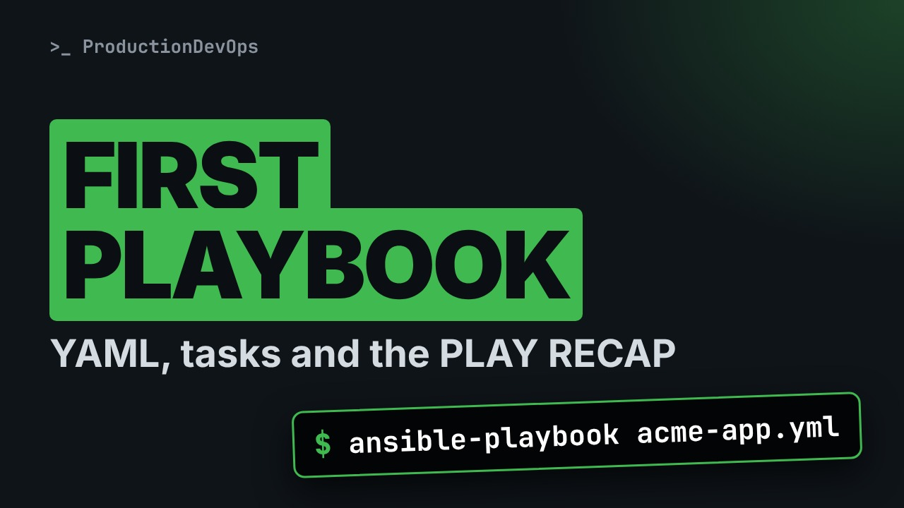
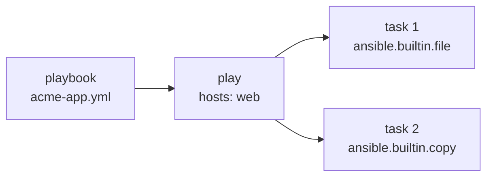

# Your First Ansible Playbook: YAML, Tasks and the PLAY RECAP, Line by Line



**Video:** coming soon on the [channel](https://www.youtube.com/@production-devops).

Lesson 8 of Ansible for RHCE. From ad hoc commands to a playbook you can run again and again. The YAML you need for Ansible (dictionaries, lists, indentation, and the quoting traps that turn 0755 into 493 and no into false), then a play line by line: name, hosts, become, tasks with full module names. We catch a mistake with --syntax-check, run the playbook, read the output line by line (ok, changed, failed, PLAY RECAP), run it again to prove idempotency, and look at -v and at a failed run. Challenge and solution in the demos repo.

## Files in this folder

- [`acme-app.yml`](acme-app.yml)
- [`ansible.cfg`](ansible.cfg)
- [`broken.yml`](broken.yml)
- [`inventory.ini`](inventory.ini)
- [`lab/up.sh`](lab/up.sh)
- [`oops.yml`](oops.yml)
- [`traps.yml`](traps.yml)
- [`challenge-solution.yml`](challenge-solution.yml) (solution of the challenge: try it yourself first)

## What you need

A Linux shell (a VM, WSL or a container is fine). Everything runs inside this folder.

## Before you start

The video runs these commands first, off screen:

```bash
if [ -f .lab-reset ]; then bash lab/up.sh; else bash lab/up.sh reset && touch .lab-reset; fi >/dev/null 2>&1
```

## The lesson, step by step

The same explanations as the video, with every command. Read it, then run it yourself.

An ad hoc command is gone once it has run. A playbook writes the end state down, so you can run it again and again. Today: your first one, and a failure you will learn to read in seconds.

### The plan

This is lesson 8 of Ansible for RHCE. Here is the plan. First, the YAML you need, and its traps. Then a play, line by line. Then we check it, run it, and read the output. And we run it again, try dash v, and read a failure.

### YAML

A playbook is a YAML file. Four rules are enough. A dictionary is key, colon, space, value. A list has one item per line, after a dash. Indentation is the structure: spaces only, never tabs. And quote anything that looks like a number or a boolean.

```
mode: 0755
version: 1.10
answer: no
quoted_mode: "0755"
quoted_version: "1.10"
quoted_answer: "no"
```

Three values with no quotes: a file mode, a version, and the word no. And the same three values, in double quotes.

What does YAML really read? A one line Python script loads the file with the library Ansible uses.

```console
$ python3 -c 'import yaml; print(yaml.safe_load(open("traps.yml")))'
```

The mode became four hundred ninety three, an octal number. The version lost its zero. And no became false. The quoted values stayed exactly as written. Quote modes, versions, and words like yes and no.

### A play

**Playbook, play, task, module**



A playbook is a list of plays. A play maps hosts to tasks, and each task calls one module, like an ad hoc command.

```
---
- name: Prepare acme-app
  hosts: web
  become: true
  tasks:
    - name: Create the app directory
      ansible.builtin.file:
        path: /srv/acme-app
        state: directory
        owner: ops
        mode: "0755"
```

Three dashes start the file. Then the first play, as a list item, with a name. hosts is the pattern: the same patterns as on the command line. become true: every task in this play runs as root. It is dash b, written down. tasks is a list. Each task starts with a dash and a name, printed in the output. Then the module, with its full name, and its arguments, one per line.

```
    - name: Write the version file
      ansible.builtin.copy:
        dest: /srv/acme-app/VERSION
        content: "1.0\n"
        owner: ops
```

The second task, at the same indentation as the first. Tasks run in order, top to bottom. copy writes the version file. In double quotes, backslash n is a newline.

### Syntax check

Before running, dash dash syntax check parses the playbook, and connects to nothing.

```console
$ ansible-playbook --syntax-check acme-app.yml
```

It only prints the playbook name: the syntax is fine. Now a copy with one space missing.

```console
$ ansible-playbook --syntax-check broken.yml
```

The error gives the file, the line and the column, and shows the lines around it. state is one space to the left of path.

A quick checkpoint. YAML is dictionaries, lists, spaces for structure, and quotes for anything ambiguous. A play has hosts, become, and tasks with full module names. Next: we run it, and read every line of the output.

### Run it

Now we run it. The output is long, so we save it in a file, and read it in parts.

```console
$ ansible-playbook acme-app.yml > run1.log
```

Did it work? The answer is at the end: the play recap. tail shows the last four lines.

```console
$ tail -4 run1.log
```

ok counts the tasks that ran fine, changed those that changed something. Three ok: but we wrote only two tasks.

Which tasks ran? grep dash capital A two prints each TASK line, and the two lines after it.

```console
$ grep -A2 TASK run1.log
```

First, a task we did not write: Gathering Facts. Ansible collects facts about each host first. Then our two tasks, with the names we wrote. Yellow changed: the directory and the file were created.

Each host gets one status per task. ok, in green: the task ran, and nothing needed to change. changed, in yellow: the task ran, and changed the host. failed, in red: the play stops for that host. Next: we run it again, and then we break it on purpose.

### Again

Now the most important run: the second one. This time a pipe sends the output straight to tail.

```console
$ ansible-playbook acme-app.yml | tail -4
```

changed is zero on both hosts. The end state was already there, so nothing was touched.

What else can Ansible tell us? Dash v adds detail. We save it in another file.

```console
$ ansible-playbook -v acme-app.yml > run3.log
```

Which config file was used? head shows the first line.

```console
$ head -1 run3.log
```

And what did a task return? grep dash m one stops at the first result for node zero one.

```console
$ grep -m1 'node01] =>' run3.log
```

### A failed run

```
---
- name: Write the message of the day
  hosts: web
  tasks:
    - name: Write /etc/motd
      ansible.builtin.copy:
        dest: /etc/motd
        content: "Managed by Ansible\n"
```

Now a play that writes slash etc slash motd. Look between hosts and tasks: there is no become.

How does a failure look? We run it, save everything, errors included, and print the exit code.

```console
$ ansible-playbook oops.yml > run2.log 2>&1; echo "exit code: $?"
```

Exit code two: at least one host failed. Scripts and pipelines can test that.

Why did it fail? We grep the error, with six lines after it.

```console
$ grep -A6 'ERROR' run2.log
```

Destination not writable, and the file and line of the task. The fix is become true.

### Gotchas

Three mistakes that cost time. A tab, or one space off, and the whole playbook fails. Check the syntax after every edit. Unquoted modes, versions, and words like no: YAML changes their type. Syntax check only parses. It does not prove the tasks will work.

### Recap

Let's recap. A play has hosts, become, and tasks with full module names. Check the syntax, run it, and read the play recap. The second run says changed zero. Exit code two: a host failed. Your challenge: fix oops dot yml. The second run must say changed zero. The solution is in the demo repository.

A playbook is your end state, written down. Next lesson: several plays in one file, become, and rolling batches with serial. Subscribe so you do not miss it.

## All the commands, to copy

Run them from inside this folder, in this order (some are expected to fail: that is the point of the demo).

```bash
python3 -c 'import yaml; print(yaml.safe_load(open("traps.yml")))'
ansible-playbook --syntax-check acme-app.yml
ansible-playbook --syntax-check broken.yml
ansible-playbook acme-app.yml > run1.log
tail -4 run1.log
grep -A2 TASK run1.log
ansible-playbook acme-app.yml | tail -4
ansible-playbook -v acme-app.yml > run3.log
head -1 run3.log
grep -m1 'node01] =>' run3.log
ansible-playbook oops.yml > run2.log 2>&1; echo "exit code: $?"
grep -A6 'ERROR' run2.log
```

## Challenge

Your challenge: fix oops dot yml. The second run must say changed zero. The solution is in the demo repository.

When you have tried: [`challenge-solution.yml`](challenge-solution.yml).

---

From the [ProductionDevOps](https://www.youtube.com/@production-devops) channel: real-world DevOps and SRE, explained with real commands.
