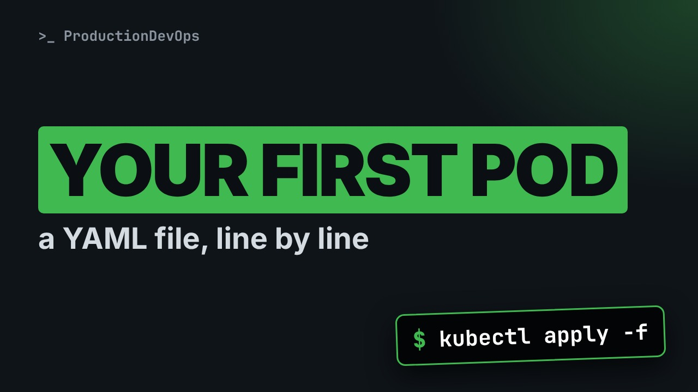
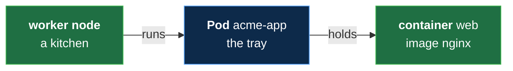
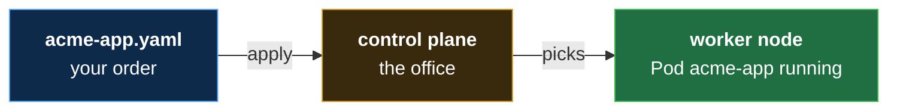

# Your First Kubernetes Pod from a YAML File: kubectl apply (No Experience Needed)



**Video:** coming soon on the [channel](https://www.youtube.com/@production-devops).

Your cluster is empty: how do you put an app on it? This lesson of Kubernetes from Zero writes your first Pod in a small YAML file, reads it line by line, and hands it to the cluster with kubectl apply. Then we hand over the same file a second time, and see why nothing changes. No experience needed: every new word is explained on screen. The file, the challenge and its solution are in the demos repo.

## Files in this folder

- [`acme-app.yaml`](acme-app.yaml)
- [`challenge-solution.sh`](challenge-solution.sh) (solution of the challenge: try it yourself first)
- [`cleanup.sh`](cleanup.sh)

## What you need

A Linux shell (a VM, WSL or a container is fine). Everything runs inside this folder.

The outputs below were captured for real on the lab cluster. On yours, names, ages, IPs and ports will differ; everything else should match.

## The lesson, step by step

The same explanations as the video, with every command and its real output. Read it, then run it yourself.

Our cluster is empty. Today you put your first app on it, with a small text file. Then we hand over the same file again, and see what happens.

You need nothing. You can just watch. To follow along, use the practice cluster from lesson four. The file of this lesson is in the demo repo.

### The plan

This is lesson five of Kubernetes from Zero. First, what a Pod is. Then a YAML file, line by line. Then we hand it to the cluster. And we hand it over a second time.

### The Pod

- `Pod`: The smallest thing Kubernetes runs: one or more containers together (like a tray: the dish travels on it, through the kitchen)
Last lesson we met the word Pod. A Pod holds one or more containers. Kubernetes moves the tray, not the single dish.

**A Pod, drawn**



Here is our Pod, acme app, on a worker node. It holds one container, called web, running nginx, a small web server.

### The YAML file

- `YAML`: A text format: one name and one value per line (like an order form: each line is a field, filled in)
To ask for a Pod, we write a YAML file. YAML is text, with a name and a value on each line. Think of an order form.

Here is the whole file. Eight lines, in three parts.

```
apiVersion: v1
kind: Pod
metadata:
  name: acme-app
spec:
  containers:
    - name: web
      image: nginx:1.27-alpine
```

The first part says what kind of thing we want. The second part gives it a name. The third part says what runs inside.

```
apiVersion: v1
kind: Pod
```

Each line is a name, a colon, a space, and a value. Api version: which version of the form. For a Pod, v one. Kind says what we want: a Pod. The capital P matters.

```
metadata:
  name: acme-app
```

Metadata means: facts about the Pod. Nothing after the colon: the next lines belong to it. Two spaces at the start say: this belongs to metadata. The name of our Pod is acme app.

```
spec:
  containers:
    - name: web
      image: nginx:1.27-alpine
```

Spec is short for specification: what we want inside the Pod. Containers: the list of containers in the Pod. A dash starts one item of a list. This container is called web. Its image is nginx, version one point twenty seven, alpine. Alpine is a small edition.

### So far

So far, three YAML rules. A name, a colon, a space, and a value. Spaces at the start of a line mean: it belongs to the line above. A dash starts one item of a list. Next: we hand the file to the cluster.

All together now: a Pod, called acme app, with one container running nginx. This file is your desired state, written down.

```
apiVersion: v1
kind: Pod
metadata:
  name: acme-app
spec:
  containers:
    - name: web
      image: nginx:1.27-alpine
```

### Apply

```console
$ kubectl apply -f acme-app.yaml
```

Here is the one new command of this lesson.

- `kubectl`: talk to the cluster
Kubectl, from lesson four: we talk to the cluster.

- `apply`: make it match the file
Apply: make the cluster match what the file says.

- `-f`: from a file
Dash f means: the wish is in a file.

- `acme-app.yaml`: which file
And this is the file.

We apply the file.

```console
$ kubectl apply -f acme-app.yaml
pod/acme-app created
```

Is it running? We ask with get pods, from lesson four.

```console
$ kubectl get pods
NAME       READY   STATUS    RESTARTS   AGE
acme-app   1/1     Running   0          29s
```

READY says one of one: one container, and it is ready. STATUS says Running. Our first app is running on the cluster.

**What just happened**



Kubectl sent the file to the office. The office picked a worker node, and the Pod started there.

### Second time

Now the open question: what if we apply the same file again?

```console
$ kubectl apply -f acme-app.yaml
pod/acme-app unchanged
```

Unchanged. The cluster already matches the file, so there is nothing to do.

The file is your desired state, written down. Apply it twice, and you get the same result, not two Pods. You can keep it, share it, and apply it on another cluster.

### Recap

Recap: a Pod is the tray that holds your container. YAML is names and values, with spaces and dashes. Kubectl apply dash f makes the cluster match the file. Your challenge: copy the file, change the name to acme app two, and apply it. How many Pods now? The solution is in the demo repo.

### Where next

Where next? Lesson six: a Pod that comes back by itself when it stops. It is called a Deployment.

Next lesson: Deployments keep your app running. Subscribe so you do not miss it.

## All the commands, to copy

Run them from inside this folder, in this order.

```bash
kubectl apply -f acme-app.yaml
kubectl get pods
```

## Challenge

Your challenge: copy the file, change the name to acme app two, and apply it. How many Pods now? The solution is in the demo repo.

When you have tried: [`challenge-solution.sh`](challenge-solution.sh).

---

From the [ProductionDevOps](https://www.youtube.com/@production-devops) channel: real-world DevOps and SRE, explained with real commands.
