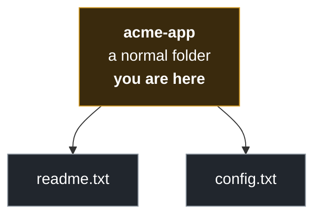
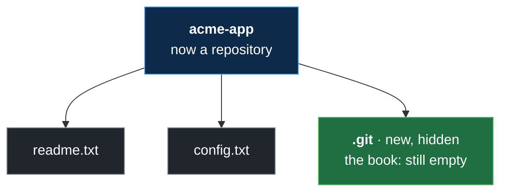
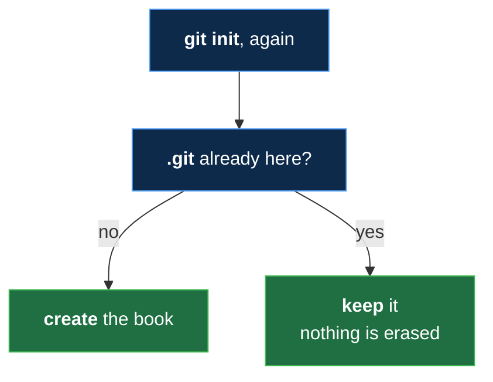

# Your First Repository: git init (Git from Zero, No Experience Needed)


**Video:** coming soon on the [channel](https://www.youtube.com/@production-devops).

Turn a normal folder into a Git repository with one command: git init. This lesson of Git and GitHub from Zero runs it for real on a tiny project, reads Git's one-line answer, finds the hidden .git folder where the history will live, and shows what happens if you run git init twice. No experience needed: every new word is explained on screen, and every command runs for real. The install guide, the challenge and its solution are in the demos repo.

## Files in this folder

- [`acme-app/config.txt`](acme-app/config.txt)
- [`acme-app/readme.txt`](acme-app/readme.txt)
- [`challenge-solution.sh`](challenge-solution.sh) (solution of the challenge: try it yourself first)
- [`setup.md`](setup.md)

## What you need

A Linux shell (a VM, WSL or a container is fine). Everything runs inside this folder.

## Before you start

The video runs these commands first, off screen:

```bash
if [ ! -e .tt-lab ]; then rm -rf /lab/git && mkdir -p /lab/git && cp -a . /lab/git/ && rm -f /lab/git/.tt-runner.sh && touch .tt-lab; fi
export HOME=/lab/git && cd /lab/git/acme-app
git config --global user.name ops && git config --global user.email ops@example.com && git config --global init.defaultBranch main && git config --global core.pager cat
PROMPT_COMMAND='HOME=/lab/git; PS1="\[\e[1;32m\]sre@lab\[\e[0m\]:\[\e[1;34m\]\w\[\e[0m\]$ "'
```

## The lesson, step by step

The same explanations as the video, with every command. Read it, then run it yourself.

Today you turn a normal folder into a repository, with one command. And at the end: what happens if you run it twice?

To follow along, you need a terminal. Linux from Zero, lesson two, shows how to get one. And Git installed. A short guide is in the demo repo. Or just watch. Every step is on screen.

### The plan

This is lesson three of Git and GitHub from Zero. First, our project folder: acme app. Then, the one new command: git init. Then, we find the hidden book. And what if you run it twice?

### The folder

**Our folder, before**



Here is our project: a folder called acme app, with two small text files. It is a normal folder. It has no history yet.

- `terminal — A window where you type commands, and the computer answers in text (like a counter where you hand in a note, and get a note back)`: 
A quick reminder: a terminal is a window where you type commands. The computer answers in text.

```
sre@lab:~/acme-app$
```

This line is the prompt. It means: ready, type your command. Before the dollar sign: tilde slash acme app. We are inside acme app.

### The command

Here is the one new command: git init. It starts a repository, right here. Git is the program. Init is short for initialize, which means start. It works in the folder you are in.

### Try it

We are inside acme app. We type git init, and press Enter.

```console
$ git init
```

One line comes back: initialized empty Git repository. It also says where. Inside acme app, in a folder called dot git.

- `.git folder — The hidden folder where Git keeps the whole history (like the shelf in your folder where the recipe book is kept)`: 
New word: the dot git folder. It is the hidden folder where Git keeps the whole history. The shelf where the recipe book is kept.

**Our folder, after**



Here is the folder now: the same two files, untouched. And one new, hidden folder: the book, still empty.

Why is it hidden? A name that starts with a dot is hidden. That is a Linux habit. You never edit it by hand. Git does that for you. And your own files did not change at all.

### So far

So far: after git init, this folder is a repository. The book lives in dot git, and it is empty. Next: what if we run it twice? Would we lose anything?

### Twice?

**git init, a second time**



Before it starts, git init checks for a dot git folder. If there is one already, it keeps it. Nothing is erased.

Let's try. A new terminal starts in acme app. We type git init, again.

```console
$ git init
```

This time the answer says: reinitialized existing Git repository. The same book, in the same place. Nothing was lost. Running it twice is safe.

### Empty book

Remember: the book exists, but it has no pages yet. Git saves nothing by itself. You choose what to save. That is lesson four.

### Good to know

Good to know. One project folder, one repository. Never run git init in your home folder. Git would watch everything in it. And git init needs no internet. It all happens on your computer.

### Recap

Recap: git init starts a repository in the folder you are in. The history lives in the hidden dot git folder. Running it twice is safe. Reinitialized, and nothing is lost. Your challenge: make a folder called shopping list, and run git init inside it. What does Git answer? The solution is in the demo repo.

### Where next

Where next? Lesson four: choosing what to save, with git add. Meet the to be signed tray.

Next lesson: choosing what to save, with git add. Subscribe so you do not miss it.

## All the commands, to copy

Run them from inside this folder, in this order (some are expected to fail: that is the point of the demo).

```bash
git init
```

## Challenge

Your challenge: make a folder called shopping list, and run git init inside it. What does Git answer? The solution is in the demo repo.

When you have tried: [`challenge-solution.sh`](challenge-solution.sh).

---

From the [ProductionDevOps](https://www.youtube.com/@production-devops) channel: real-world DevOps and SRE, explained with real commands.
