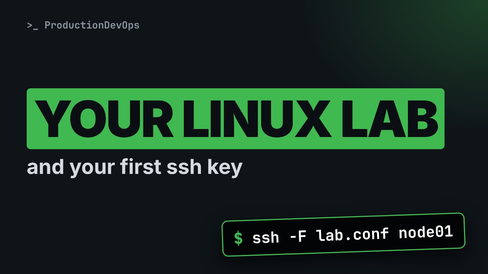
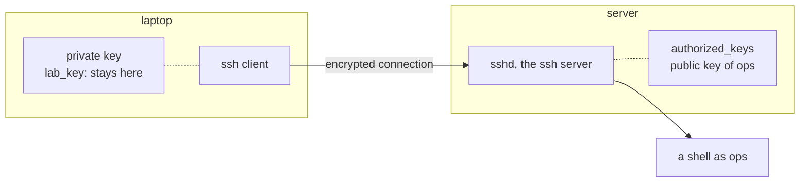

# Your Linux Lab: VM, WSL, Container or Cloud, and Your First SSH Login



**Video:** coming soon on the [channel](https://www.youtube.com/@production-devops).

To learn Linux you need a system you can break without fear. In lesson 2 we compare the four lab options (a VM, WSL, a container, a cloud server), see how to follow the course, take a quick look at the GNOME desktop, then make a real ssh connection with a key: key pair, authorized_keys, a short client config and known_hosts. We finish with a quick tour of the commands the course uses. Lesson 2 of Linux from User to Server Admin.

## Files in this folder

- [`.lab/sshd.tmpl`](.lab/sshd.tmpl)
- [`lab.conf`](lab.conf)
- [`challenge-solution.sh`](challenge-solution.sh) (solution of the challenge: try it yourself first)

## What you need

A Linux shell (a VM, WSL or a container is fine). Everything runs inside this folder.

## Before you start

The video runs these commands first, off screen:

```bash
command -v sshd >/dev/null 2>&1 || ls /usr/sbin/sshd >/dev/null 2>&1 || DEBIAN_FRONTEND=noninteractive apt-get install -y -qq openssh-server openssh-client >/dev/null 2>&1
mkdir -p /run/sshd; id ops >/dev/null 2>&1 || useradd -m -s /bin/bash ops; usermod -p '*' ops
pkill -f '[s]shd -f /tmp/techtube[^ ]*/your-linux-lab/'; sed "s#DEMO#$PWD#g" .lab/sshd.tmpl > .lab/sshd.conf; [ -f .lab/host_key ] || ssh-keygen -q -t ed25519 -N '' -f .lab/host_key; /usr/sbin/sshd -f "$PWD/.lab/sshd.conf"
for i in 1 2 3 4 5 6 7 8 9 10; do (exec 3<>/dev/tcp/127.0.0.1/2222) 2>/dev/null && break; sleep 0.3; done
```

## The lesson, step by step

The same explanations as the video, with every command. Read it, then run it yourself.

To learn Linux, you need a system you can break without fear. Let's pick your lab and log in with an ssh key. Watch the first login: ssh prints a line it will never print again.

### The plan

This is lesson 2 of Linux from User to Server Admin. First, four ways to get a lab. Then how to follow the course. Then your first ssh login, with a key. Finally, a quick tour of commands.

### Lab options

```
Option      Best for                          Limits
VM          everything: systemd, SELinux,     needs about 2 GB RAM, 20 GB disk
            disks, boot, networking
WSL 2       a fast shell on Windows           no SELinux, Microsoft's kernel
Container   throwaway shells and scripts      no systemd, the host's kernel
Cloud VM    a real server on the internet     costs money, must be secured
```

A virtual machine is a complete computer in software, with VirtualBox, Hyper-V or KVM. WSL 2 runs Linux inside Windows: a quick shell, but no SELinux. A container starts in a second and is gone when you exit, usually with no systemd. A cloud VM is a real server: it costs money, and gets attacked from minute one.

So here is the setup I suggest. Your main lab: an AlmaLinux 9 VM, with a snapshot. Optional: Ubuntu 24.04, for the differences. For the shell lessons, any container is enough. And never practise on a production server.

### The desktop

AlmaLinux and Ubuntu both use the GNOME desktop. The Super key, the Windows key, opens Activities, where you search apps. Type terminal and press Enter: this course happens there. Servers usually have no desktop: you manage them over ssh.

### Your first ssh login

**How an ssh key login works**



ssh opens an encrypted connection to the ssh server, called sshd. You keep a private key on your computer, and the server keeps your public key, in a file called authorized keys. If the two keys match, you get a shell, with no password.

```console
$ ssh-keygen -t ed25519 -f lab_key -N '' -q
```

Step one: a key pair. Here is the command, piece by piece.

- `ssh-keygen`: creates a key pair
ssh keygen creates a private key and a public key.

- `-t ed25519`: the key type
Dash t picks the type: ed25519, the modern one.

- `-f lab_key`: the file name
Dash f is the file name. The public key adds dot pub.

- `-N ''`: empty passphrase: lab only
Dash capital N with empty quotes: no passphrase. Lab only.

- `-q`: quiet
Dash q: quiet.

We run it.

```console
$ ssh-keygen -t ed25519 -f lab_key -N '' -q
```

Which files did it create, and who can read them? ls dash l shows the permissions on the left.

```console
$ ls -l lab_key lab_key.pub
```

The private key, rw and then dashes, is readable only by you, or ssh refuses it. The dot pub file is public.

Our lab server already runs here, on port 2222. It trusts the keys in the file authorized keys, in this folder.

```console
$ cp lab_key.pub authorized_keys
```

On a real server, it is dot ssh slash authorized keys, in the user's home, and ssh copy id puts your key there.

A quick checkpoint. Your main lab is an AlmaLinux VM. Containers and WSL are for quick shells. The private key stays with you. The public key goes into authorized keys. Next: a short name for the server, and the line ssh prints only once.

To avoid long commands, ssh reads a client config file: normally dot ssh slash config, here lab dot conf.

```
Host node01
    HostName 127.0.0.1
    Port 2222
    User ops
    IdentityFile lab_key
    UserKnownHostsFile known_hosts
    StrictHostKeyChecking accept-new
```

Host node01 is the short name we will type. HostName and Port: where the server is. Here port 2222; normally 22. User and IdentityFile: who we log in as, with which private key. known hosts remembers each server. accept new trusts a new one once, and refuses it if its key changes.

Now we connect. Dash capital F picks our config file, then the short name, then the command to run there: whoami.

```console
$ ssh -F lab.conf node01 whoami
```

First line: the server was added to known hosts. Second line: we are ops, with no password. The second time, that line is gone: ssh already knows this server. pwd prints the home folder of ops.

```console
$ ssh -F lab.conf node01 pwd
```

With no command at the end, ssh opens a shell on the server. exit comes back.

### Terminals

Where do you type all this? In a terminal. GNOME Terminal on Linux, Windows Terminal on Windows, Terminal on a Mac. ssh is built in on all three. Copy and paste are Control Shift C and Control Shift V. Control C alone stops a command.

### A quick tour

```
pwd   ls   cd          where am I, what is here, go there
cat   less             show a file; less pages it, q quits
mkdir cp  mv  rm       make, copy, move, remove
man ls   ls --help     read the manual, or the short help
sudo                   run one command as root
ssh   exit             connect to a server, leave it
```

pwd, ls, cd: where am I, what is here, go there. cat and less show files. mkdir, cp, mv, rm change files. man and dash dash help are the manual. sudo runs one command as root; ssh and exit you just saw.

ls lists this folder: the keys, the config, and known hosts.

```console
$ ls
```

echo with a greater than sign writes a line into a file. More in lesson 4.

```console
$ echo "acme-app started" > app.log
```

cat shows the file.

```console
$ cat app.log
```

### Gotchas

Two things to get right from day one. One. The private key never leaves your computer. Only the dot pub file goes to servers. Two. If ssh warns that a host key changed, stop. The server was reinstalled, or someone is in the middle.

### Recap

Let's recap. Your main lab is an AlmaLinux 9 VM, with snapshots. Create the key pair, put the public key in authorized keys, connect. The ssh config holds short names, and known hosts remembers servers. Your challenge: in your own lab, copy a key with ssh copy id and log in with a short name. The solution is in the demo repository.

You now have a lab you can break, and a key that logs you in. Next lesson: how the shell reads your command. Subscribe to follow the course.

## All the commands, to copy

Run them from inside this folder, in this order (some are expected to fail: that is the point of the demo).

```bash
ssh-keygen -t ed25519 -f lab_key -N '' -q
ls -l lab_key lab_key.pub
cp lab_key.pub authorized_keys
ssh -F lab.conf node01 whoami
ssh -F lab.conf node01 pwd
ls
echo "acme-app started" > app.log
cat app.log
```

## Challenge

Your challenge: in your own lab, copy a key with ssh copy id and log in with a short name. The solution is in the demo repository.

When you have tried: [`challenge-solution.sh`](challenge-solution.sh).

---

From the [ProductionDevOps](https://www.youtube.com/@production-devops) channel: real-world DevOps and SRE, explained with real commands.
